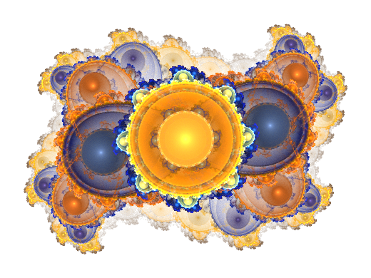
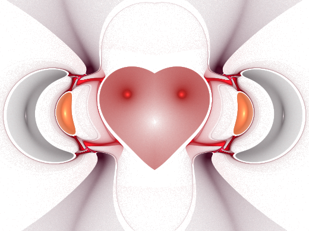
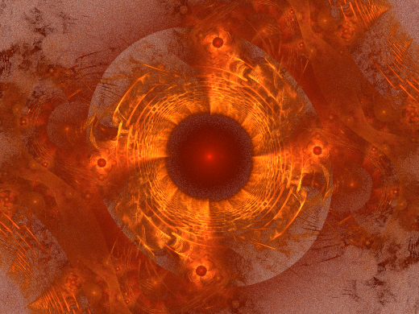
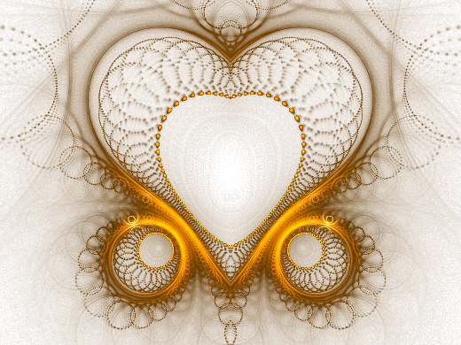
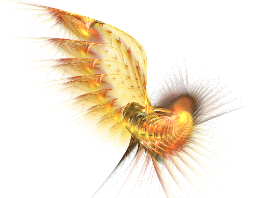
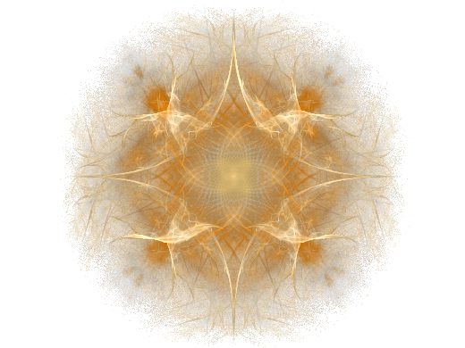
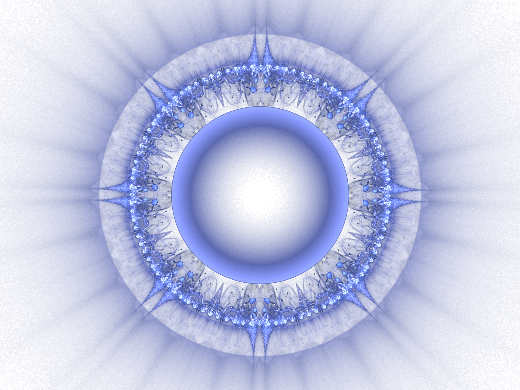

# Flame rendering engine

A C++20 library (buildable as static or shared) for parsing, manipulating, and rendering Apophysis-compatible fractal flames (`.flame` XML files) to PNG images.

## References
- Original [fractal flame algorithm](https://flam3.com/flame_draves.pdf) by Scott Draves.
- Old [Apophysis 2.09](https://sourceforge.net/projects/apophysis/) sources and builds.
- [Flam3 renderer](https://github.com/scottdraves/flam3) by Scott Draves and Erik Reckase.

## Platform compatibility
It is tested and verified against Windows (Visual Studio Community 2022) and Linux (GCC 16.2.1) on Intel i7 CPUs.

## Sample Gallery

Sample renders from `tests/golden/renders.flame`:

| | | |
| :---: | :---: | :---: |
| <br>*A Gift Ribbon nr 2* | <br>*Apophysis-060731-37* | <br>*Apophysis-060906-3* |
| <br>*Cosmic Tonality* | <br>*Glass Triangles* | <br>*Golden Gate* |
| <br>*Heartwork* | <br>*Julia Carpet* | <br>*Nightingale* |
| <br>*Struggle within* | <br>*VirtualAlchemy center* | <br>*VirtualAlchemy external* |
| <br>*Wooden Mandala* | | |

## Features

- **Apophysis `.flame` XML Support** — Load and serialize single flames or multi-flame collections (`FlameXmlSerializer`), including 256-color palettes (`<palette>` and `<colors>`), affine transforms, post-transforms, final transforms, chaos/xaos transition weights (`modWeights`), and variation parameters.
- **40 Fractal Variations** — Supports standard and parametric Apophysis variations:
  - *Standard*: `linear`, `sinusoidal`, `spherical`, `swirl`, `horseshoe`, `polar`, `handkerchief`, `heart`, `disc`, `spiral`, `hyperbolic`, `diamond`, `ex`, `julia`, `bent`, `waves`, `fisheye`, `popcorn`, `exponential`, `power`, `cosine`, `rings`, `fan`, `eyefish`, `bubble`, `cylinder`, `noise`, `blur`, `gaussian_blur`, `pre_blur`
  - *Parametric*: `blob`, `curl`, `fan2`, `julian`, `juliascope`, `pdj`, `perspective`, `radial_blur`, `rectangles`, `rings2`
- **Multi-Threaded CPU Renderer** — Chaos Game renderer (`FlameCpuRenderer` implementing `IFlameRenderer`) with precompiled transforms (`PreparedTransform`), [Xoshiro256** PRNG](https://en.wikipedia.org/wiki/Xorshift) (`FastRng`), configurable thread count, deterministic seeding, progress callbacks, and cooperative cancellation.
- **Apophysis-Faithful Tone Mapping & Filtering** — Log-density tone mapping with gamma, vibrancy, brightness, contrast, spatial oversampling, and Gaussian filtering (`FlameToneMapper`).
- **PNG I/O** — Load and save RGB/RGBA PNG images via `FlameImage`.
- **Procedural & Editing Helpers** — Random flame and gradient generation (`FlameFractal::createRandom`, `FlameGradient::createRandom`), symmetry insertion (`addSymmetry`), weight normalization/equalization, and hue rotation.

## Requirements

- CMake 3.24+
- A C++20-compatible compiler (MSVC, GCC, or Clang)
- Git (for fetching dependencies via CMake `FetchContent` when not already provided)

### Dependencies

Fetched automatically by CMake if not already defined as targets:

- [pugixml](https://github.com/zeux/pugixml) `v1.14` (XML parsing/serialization, linked `PRIVATE`)
- [lodepng](https://github.com/lvandeve/lodepng) (PNG encoding/decoding, linked `PRIVATE`)
- [GoogleTest](https://github.com/google/googletest) `v1.14.0` (tests only, when `FLAME_RENDER_BUILD_TESTS=ON`)

## Building & Running Tests

```bash
cmake -B build -DCMAKE_BUILD_TYPE=Release
cmake --build build --config Release
ctest --test-dir build -C Release --output-on-failure
```

To build as a shared (dynamic) library instead of the default static library:

```bash
cmake -B build -DCMAKE_BUILD_TYPE=Release -DBUILD_SHARED_LIBS=ON
```

To disable building tests (enabled by default only when `flame_render` is the top-level CMake project):

```bash
cmake -B build -DFLAME_RENDER_BUILD_TESTS=OFF
```

The test suite includes:
- **Unit tests** (`tests/test_flame_fractal.cpp`, `tests/test_renderer.cpp`) covering transforms, variations, gradients, XML round-tripping, tone mapping, and renderer behavior.
- **Golden image tests** (`tests/test_golden_samples.cpp`) verifying rendered output against 13 Apophysis reference PNGs in `tests/golden/` using premultiplied-alpha MAE and block PSNR metrics.

## CMake Integration

Link against the `flame_render::flame_render` target via `add_subdirectory` or `FetchContent`:

```cmake
add_subdirectory(path/to/flame_render)
target_link_libraries(your_target PRIVATE flame_render::flame_render)
```

## Quick Start

```cpp
#include <iostream>

#include "core/FlameFractal.h"
#include "renderer/FlameCpuRenderer.h"

int main() {
    // Load one or more fractals from an Apophysis .flame file
    auto fractals = flame::FlameFractal::loadFromXmlFile("tests/golden/renders.flame");
    if (fractals.empty()) {
        return 1;
    }

    flame::FlameCpuRenderer renderer;
    renderer.setFractal(&fractals[0]);

    flame::RenderOptions options;
    options.width = 800;
    options.height = 600;
    options.quality = 100.0;
    options.oversample = 2;
    options.transparent = true;
    options.onProgress = [](double progress) {
        std::cout << "Progress: " << static_cast<int>(progress * 100.0) << "%\r" << std::flush;
    };

    flame::FlameImage image = renderer.render(options);
    image.savePng("output.png", true);

    const flame::RenderStats stats = renderer.getLastStats();
    std::cout << "\nRendered " << stats.totalSamples << " samples in "
              << stats.renderTimeSeconds << "s ("
              << stats.iterationsPerSecond / 1e6 << "M it/s)\n";
    return 0;
}
```

You can also generate a fractal procedurally without a `.flame` file:

```cpp
auto fractal = flame::FlameFractal::createRandom(/*minXforms=*/3, /*maxXforms=*/5, /*seed=*/42);
fractal.width = 512;
fractal.height = 512;
```

## Project Structure

```text
flame_render/
├── CMakeLists.txt
├── src/
│   ├── core/
│   │   ├── FlameFractal.{h,cpp}        # Fractal parameters, camera, symmetry, random generation
│   │   ├── FlameGradient.{h,cpp}       # 256-entry color palette, hex parsing/serialization, hue rotation
│   │   ├── FlameTransform.{h,cpp}      # Affine/post transforms, xaos weights, PreparedTransform, FastRng
│   │   ├── FlameVariation.{h,cpp}      # 40 variation definitions and parameters
│   │   └── FlameXmlSerializer.{h,cpp}  # Apophysis .flame XML load/save
│   └── renderer/
│       ├── IFlameRenderer.h            # Renderer interface, RenderOptions, Bucket64, RenderStats
│       ├── FlameCpuRenderer.{h,cpp}    # Multi-threaded CPU Chaos Game renderer
│       ├── FlameToneMapper.{h,cpp}     # Log-density tone mapping & spatial filtering
│       └── FlameImage.{h,cpp}          # RGBA image buffer & PNG load/save
└── tests/
    ├── CMakeLists.txt
    ├── test_flame_fractal.cpp
    ├── test_renderer.cpp
    ├── test_golden_samples.cpp
    └── golden/                         # Reference .flame file and 13 Apophysis golden PNGs
```

## License

This project is licensed under the **GNU General Public License v3.0 or later** (`GPL-3.0-or-later`) — see the [LICENSE](LICENSE) file for details.
